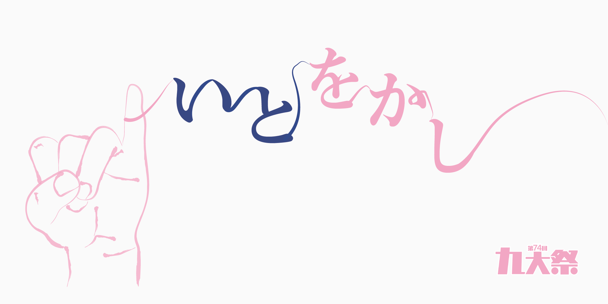

## Overview

第74回「いとをかし」は、会場写真に紺と桃色の枠、白い本文面を重ねたデザインです。明朝体の見出しと細い線を組み合わせ、華やかさの中に落ち着きを持たせています。

テーマには「伊都キャンパス」「いとをかし」の「いと」と、人と人のつながりを表す「糸」が重ねられています。ロゴでは文字と小指を細い線でつなぎ、その関係を表現しています。

このページは保存サイトをもとに、配色と構成を紹介しています。

## Colors

紺と桃色は枠・見出し・リンクに使います。写真の上で本文を読む場所には、白い面を敷きます。

| 色 | 値 | 用途 |
| --- | --- | --- |
| 紺 | `#303e71` | 見出し、リンク枠、フッター |
| 桃色 | `#ffadcc` | 枠のグラデーション、マーカー、リンクの反応 |
| 本文 | `#010101` | 基本文字 |
| 本文の面 | `#fafafa` | カード内部、詳細ページ |
| フッターの補足 | `#9da7cc` | 著作権表示、区切り線 |

ヘッダーは暗い色から透明へ移る背景で、会場写真に重ねます。本文の白い面と、背景を見せる領域を使い分けています。

## Typography

本文はOpen SansとNoto Sans JP、見出しや主要なリンクはShippori Minchoを使います。明朝体はテーマの表情を担い、企画の説明はゴシック体で読みやすくまとめます。

| 用途 | 文字の指定 |
| --- | --- |
| 詳細ページの見出し | 16〜18pt |
| 節の見出し | 13〜15pt、太さ800 |
| 小見出し | 11〜13pt、紺の下線 |
| 企画カードの見出し | 16px、太さ700 |

詳細ページでは、画面幅500pxを境に文字サイズを切り替えます。小さな説明文字を新しい画面で使う場合は、文字を拡大しても読める大きさと配置に調整してください。

## Layout

トップはロゴ、案内カード、ステージ企画の順に続きます。ロゴの領域は幅80%・最大700px、案内カードを並べる領域は最大1200pxです。

広い画面では大小のカードを組み合わせ、幅850px以下では一列に並べます。詳細ページは中央の本文面を基本とし、内側の余白を広い画面で上下20px・左右30px、狭い画面で上下10px・左右20pxにします。

ステージ企画は横に並べ、手動でスクロールして探す構成です。写真、企画名、団体名、会場、関連リンクを一つのカードにまとめています。

## Elevation & Depth

会場写真を画面の背景に固定し、その上に白い本文面を重ねます。ステージ企画の領域には背景のぼかしを使い、写真と案内を分けています。

ギャラリーの写真は、ポインターを重ねると上に10px動き、影が付きます。情報を読む面は落ち着かせ、写真への反応に動きを使う構成です。

## Shapes

カードと本文の外枠は、紺から桃色へ移るグラデーションです。外側を10px、内側を9pxの角丸にし、白い面の周囲に細く色を残します。

カード内のリンクは、5pxの角丸と紺の2px枠を使います。案内欄の市松模様、正方形に切り抜いた写真、糸のような線をそれぞれの用途に合わせて配置しています。

## Components

| 要素 | 役割と特徴 |
| --- | --- |
| 案内カード | 写真・テーマ・パンフレットなどへの入口。白い面とグラデーション枠を共通にする |
| カード内リンク | 紺の枠。ポインターを重ねると紺の面と白い文字に変わる |
| ステージ企画 | 写真と企画情報をまとめた横長のカード |
| 詳細本文 | 見出し帯と、中央に置いた白い本文面 |
| フッター | 紺の背景にロゴ、分類したリンク、SNS、協賛情報 |

## Do's and Don'ts

再利用するときは、写真と装飾の華やかさを生かしつつ、案内の読みやすさを確保してください。

| 生かす表現 | 避ける使い方 |
| --- | --- |
| 写真の上に白い本文面を置く | 明暗のある写真へ小さな本文を直接重ねる |
| 枠や細い線でテーマを表す | 装飾でリンクや見出しを見分けにくくする |
| 日時・会場・企画名を文字でも示す | 時刻や企画名をタイムテーブル画像の中だけに記載する |
| 写真の反応に動きを使う | キーボード操作や動きを減らす設定を省く |
