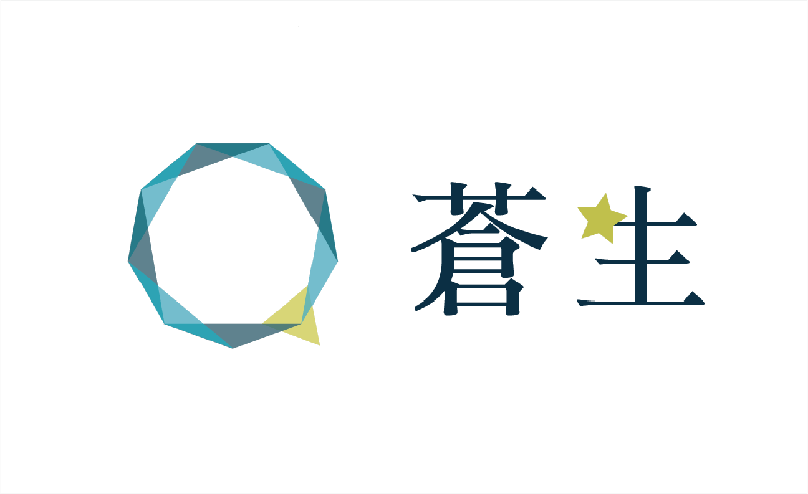

## Overview

第75回「蒼生」は、青い多角形と星、斜めの背景帯を組み合わせたデザインです。動きを感じさせる図形の構図に、特集や企画を紹介する白いカードを配置しています。

「蒼生」は多くの人々を意味します。久しぶりの対面開催への思いと、秋の晴れた蒼空を重ねたテーマです。ロゴは青系の三角形で輪をつくり、黄色い星を添えています。

このページは保存サイトをもとに、配色と構成を紹介しています。

## Colors

青を基調に、水色・青緑・黄緑を案内のアクセントに使います。本文は濃い灰色、カードは白を基本にしています。

| 色 | 値 | 用途 |
| --- | --- | --- |
| 濃い青 | `#264F70` | ヘッダー、フッター |
| 明るい青 | `#458AC1` | ヘッダーの斜めの面 |
| 見出し | `#00293E` | 見出しと短い下線 |
| 本文 | `#343434` | 基本文字 |
| 水色 | `#23a3b6` | 企画ラベル、リンク、マーカー |
| 青緑 | `#006470` | リンクの反応、カードの境界 |
| 黄緑 | `#BABA4C` | ラベル、枠、マーカー |
| 薄いクリーム | `#FDFBEE` | 特集領域、斜めの背景帯 |

半透明の本文面には`#F7F8F8DD`を使います。透明度を含む色は、重なる背景との組み合わせで確認してください。

## Typography

本文はOpen SansとNoto Sans JPです。テーマロゴの文字は画像として扱い、本文の書体とは分けています。

| 用途 | 文字の指定 |
| --- | --- |
| ページ見出し | 20pt、太さ600、字間0.5px |
| 見出し下の線 | 幅30px、高さ2px |
| トップの節見出し | 30px、太さ700 |
| 特集カードの見出し | 18px、太さ700 |
| 開催日の数字 | 広い画面で50px、狭い画面で26px |

大きな開催日の数字と短い見出しで、トップページの情報に強弱を付けています。

## Layout

トップはテーマロゴと開催日から始まり、「特集」「企画を探す」、来場案内へ続きます。斜めのクリーム色・灰色の帯と星の装飾で、領域同士をつないでいます。

特集と企画種別のカードは横に並べ、手動でスクロールして探します。詳細本文は最大1000pxとし、写真と説明は画面幅に合わせて縦・横に並べ替えます。

広い画面の構図をそのまま縮めず、狭い画面ではテーマロゴを画面幅に合わせて大きく表示し、開催情報の文字サイズを調整します。

## Elevation & Depth

詳細本文は、灰色の細線と淡い外縁を重ねた二重の囲みです。特集カードには`3px 3px 5px #45454588`の影を付け、背景の斜面にも影を使っています。

斜めの背景帯は大きな領域の切り替え、カードの影は個々の入口の区別に使います。両方を強くしすぎないよう、白い面に情報をまとめます。

## Shapes

情報カードは直線的な形を基本とします。中央のリンクは5px、補足画像は7pxの角丸です。

星の鎖、九角形、多角形、斜めの帯を繰り返し、ページ全体にまとまりをつくります。出演者の写真は全体を収め、企画種別の写真は装飾の枠に合わせて切り抜きます。

## Components

| 要素 | 役割と特徴 |
| --- | --- |
| 特集カード | 幅180px・高さ290px。上に画像、下にラベルと案内文 |
| 企画種別のカード | 200px角の図形と写真、下部の名称 |
| 案内リンク | 白い面に案内文と右向きの印を置く |
| タイムテーブル | 日付・会場別の表。時刻と企画名、写真、詳細リンク |
| モバイルメニュー | 右から開く白い全画面のパネル |
| フッター | 濃い青の背景にロゴ、SNS、関連リンク、連絡先 |

## Do's and Don'ts

青い図形、星、斜めの帯でテーマを表し、情報カードは見通しのよい配置にします。

| 生かす表現 | 避ける使い方 |
| --- | --- |
| 図形と背景帯で領域をつなぐ | 装飾の位置に合わせて本文を無理に固定する |
| 水色・黄緑をラベルに使う | 明るい背景に、コントラストを確認せず小さな白文字を重ねる |
| 開催情報を文字で示す | 日時を画像内だけに入れる |
| 開閉状態の分かるメニューを使う | 閉じたメニューへキーボードで移動できる状態を残す |
