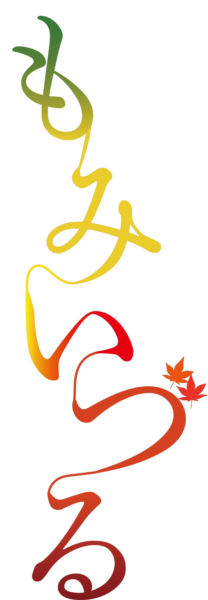

## Overview

第76回「もみいづる」は、深い赤褐色に紅葉を重ねたデザインです。縦長のテーマロゴと縦組みのフッターで秋の表情をつくり、詳しい案内には半透明の白い面を使っています。

ロゴは緑から黄、赤、深紅へと色が移ります。葉の形は背景、見出し、企画カードの枠にも繰り返し使われています。

このページは保存サイトをもとに、配色と構成を紹介しています。

## Colors

| 色 | 値 | 用途 |
| --- | --- | --- |
| 深い赤褐色 | `#321215` | 背景、ヘッダー、メニュー、白い面上の文字 |
| 明るい文字 | `#fefefe` | 暗い面の文字、見出しの線 |
| フッター | `#673f3f` | 縦組みリンクと協賛情報の背景 |
| 本文の面 | `#ffffffe0` | 詳細ページの半透明の白 |
| 赤橙 | `#e2421f` | 見出しの破線、リンクの反応、選択中の分類 |
| 黄緑 | `#95a318` | 小見出しの点線 |
| 非選択の分類 | `#d9d9d9` | テント・館内企画の切り替え |

濃い背景と明るい文字、白い本文面と赤褐色の文字を使い分けています。

## Typography

トップの開催情報と共通本文にはBIZ UDPMincho、詳細見出しにはCentury・Yu Mincho系の明朝体を指定しています。ステージの本文にはOpen Sans・Noto Sans JPを使います。

| 用途 | 広い画面 | 狭い画面の例 |
| --- | --- | --- |
| トップの祭名 | 80px | 35px |
| 開催回・日時 | 40px | 14px |
| メニュー | 20px | 20px |
| 詳細の節見出し | 17pt | 10〜12pt |
| 詳細本文の行高 | 25px | 25px |

書体が端末にない場合は代替書体になります。再利用する場合は書体の読み込みを用意し、文字幅が変わっても配置が崩れないようにしてください。

## Layout

トップでは縦長のロゴを中央寄りに置き、右側に開催情報、左右に葉を配置します。その下に新着情報と企画案内を続けます。

情報領域は幅90%を基本に中央へ置きます。詳細本文は幅1000pxを上限に、画面端から余白を取ります。内側には上下10px・左右20pxの余白を設けています。

画面幅767px以下では、主要なリンクを開閉メニューにまとめ、企画カードを200px角から150px角へ縮めます。装飾の葉と開催情報も、画面幅に応じて位置や大きさを変えています。

## Elevation & Depth

トップの情報領域は、透明から白へ移るグラデーションで背景とつながります。詳細ページでは葉を固定背景に置き、その上に半透明の白い本文面を重ねます。

本文面に影は付けず、背景色と余白で区切っています。見出しには上下線や破線を使い、装飾の多い背景でも情報のまとまりが分かる構成です。

## Shapes

葉の形を背景と見出しで反復します。節見出しの左の葉は45px角、狭い画面では35px角です。企画カードは写真と葉の枠を重ねています。

中央のリンクには5pxの角丸と1.5pxの枠を使います。本文面や見出しまで一律に角丸で囲まず、直線や葉の輪郭を生かしています。

## Components

| 要素 | 役割と特徴 |
| --- | --- |
| トップのテーマ領域 | 縦長ロゴ、開催情報、左右の葉を大きく配置 |
| 新着情報・企画案内 | 上下の線と葉を添えた見出し、横スクロールの一覧 |
| 企画カード | 葉の枠と写真を重ねた正方形の入口 |
| 詳細の節見出し | 左の葉と赤橙の破線 |
| 分類の切り替え | テントはゾーン、館内は階、タイムテーブルは日付で選ぶ |
| フッター | 縦組みの分類リンク。協賛・著作権は別の領域 |

メニューは右側から開く構成です。企画の一覧は手動の横スクロールを使います。

## Do's and Don'ts

葉、赤褐色、縦組みはこの年度の特徴です。装飾を生かしながら、案内と操作に必要な広さを確保します。

| 生かす表現 | 避ける使い方 |
| --- | --- |
| 縦長ロゴと葉で構図をつくる | 位置や高さを固定し、文字を拡大すると内容が重なる構成にする |
| 明朝体と半透明の白い面を組み合わせる | 小さい本文を背景の葉へ直接重ねる |
| 選択中の分類を文字と色で示す | 選択状態を色だけで示し、マウスのクリックでしか切り替えられない構成にする |
| メニューをボタンで開閉する | 閉じた項目へのフォーカス移動を残す |
