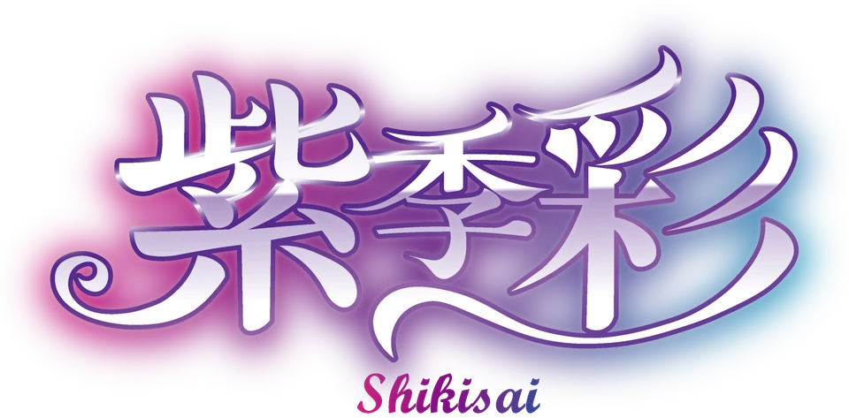

## Overview

第77回「紫季彩」は、紫の濃淡で領域を分け、写真に白い文字を重ねた案内へつなぐデザインです。赤紫から青へ移るロゴと明朝体の見出しを組み合わせ、詳しい情報は白い半透明の本文面に置いています。

テーマの「紫」には、未熟を表す青と成熟を表す赤を重ね、九大祭の進歩を込めています。夏の赤から冬の青へ移る11月を「紫季」、九州大学の多様性を「彩」としています。

このページは保存サイトをもとに、配色と構成を紹介しています。

## Colors

濃い紫はテーマ説明、淡い紫は案内、白い面は本文に使います。単一の紫で全体を塗らず、領域ごとに濃さを変えています。

| 色           | 値                   | 用途                         |
| ------------ | -------------------- | ---------------------------- |
| 淡い紫       | `#b298e2`            | ヘッダー、メニュー           |
| 濃い紫       | `#544474`            | テーマ説明の背景             |
| 灰みのある紫 | `#8782a9`            | 写真を使った案内、下部の背景 |
| フッター     | `#8f7eb6`            | サイト案内、連絡先           |
| 本文         | `#050001`・`#000000` | 白い面の文字                 |
| 白い本文面   | `#ffffffe0`          | 詳細ページの半透明の面       |
| 金色の線     | `#d8b762`            | 小見出しの二重線             |
| リンクの反応 | `#9f82d8`            | 中央に置くリンクの背景       |

半透明の背景は、重なる色や写真によって印象が変わります。実際の組み合わせで文字の読みやすさを確認してください。

## Typography

本文はOpen Sans・Noto Sans JP、祭名や節見出しには明朝体を使います。ロゴの装飾文字は画像として扱います。

| 用途               | 文字の指定                          |
| ------------------ | ----------------------------------- |
| トップの祭名       | Yu Mincho、太さ500                  |
| 節の見出し         | Century・Yu Mincho系、17pt、太さ900 |
| 小見出し           | Century・Yu Mincho系、17px、太さ900 |
| 写真上の案内       | 本文書体、15pt                      |
| 上部ナビゲーション | 20px                                |
| 開閉メニュー       | 18px                                |

CenturyやBIZ UDPMinchoなど、表示環境に依存する書体の指定もあります。文字幅が変わっても、写真や装飾と重ならない余白を取ります。

## Layout

トップは祭名とロゴ、開催情報、テーマ説明、来場案内、本部企画、その他のコンテンツへ続きます。テーマロゴは幅85%・最大700pxで中央に置きます。

幅600px以下では上部の主要リンクをメニューにまとめます。メニュー内は縦にスクロールでき、狭い画面でも項目をたどれる構成です。

写真による案内は、大きな画像と短い名前で行き先を示します。詳細ページは白い本文面に見出し、画像、説明、会場をまとめます。

## Elevation & Depth

開催情報の白い半透明の面には柔らかい影、写真を使った案内には右下へずれた濃い影を付けます。写真の白い3px枠と影で、紫の背景から入口を際立たせています。

詳細本文には影を付けず、白い面と黒い文字で読ませます。テーマを見せる領域と、案内を読む領域で重なり方を変えています。

## Shapes

テーマ領域の上端を斜めに切り、前後の面を重ねます。写真は直線の白い枠で囲み、見出しやメニュー付近には折り紙を思わせる紫の図形を置きます。

中央のリンクは5pxの角丸と1.5pxの灰色枠です。写真や本文の枠まで同じ角丸にせず、用途ごとの輪郭を保ちます。

## Components

| 要素             | 役割と特徴                                 |
| ---------------- | ------------------------------------------ |
| 固定ヘッダー     | 左にロゴ、右に主要リンクとMENU             |
| テーマロゴ       | 赤紫から青への階調と白い装飾文字           |
| 開催情報         | 最大幅500pxの半透明の面                    |
| 写真を使った案内 | 白い枠と濃い影、写真上の名称               |
| 企画の詳細       | 企画名、画像、日時、説明、会場をまとめる   |
| 協賛画像         | 画像ごとの縦横比を保ち、複数の大きさで配置 |

メニューは右端から開きます。大きな写真を入口として使い、本文へ進む前に内容が分かる名前を添えています。

## Do's and Don'ts

紫の階調、白いロゴ、写真、斜めの境界を組み合わせる際は、文字を読む場所を明確にします。

| 生かす表現                                                   | 避ける使い方                                             |
| ------------------------------------------------------------ | -------------------------------------------------------- |
| 領域ごとに紫の濃さを変える                                   | 淡い紫の上へ薄い文字を置く                               |
| 写真の枠と影で入口を示す                                     | 写真に文字を重ねる際に、背景とのコントラストを確認しない |
| 斜めの境界に余白を取る                                       | 固定位置や負の余白で本文を重ねる                         |
| メニューを閉じたら、開くときに使ったボタンへフォーカスを戻す | クリックだけで開閉し、読み上げやキーボード操作を省く     |
