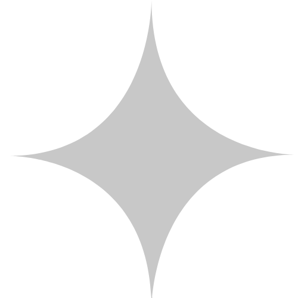

## Overview

第78回「星瞬」は、星空に白い明朝体と銀色の星を重ねたデザインです。円弧や細い線で大きな構図をつくり、企画を探す領域には検索とお気に入りを用意しています。

二日間を流星のような短い瞬間と捉え、準備の日々や当日の感動が心に残る「セイシュン」になるようにという思いを込めたテーマです。

四芒星は、見出しや領域の境界に使う装飾です。白いテーマロゴは、暗い星空の背景と組み合わせます。

このページは保存サイトをもとに、配色と構成を紹介しています。

## Colors

| 色・背景 | 値 | 用途 |
| --- | --- | --- |
| 夜空のグラデーション | `#080e13` → `#0c3e5a` | 詳細ページの背景 |
| 星空画像 | 濃紺の空と小さな光点 | トップの固定背景 |
| 見出し | `#f1f1f1`・`#ffffff` | 暗い背景上の文字 |
| 線・装飾 | `#cacaca` | 見出しの線、案内の装飾 |
| お知らせの日付 | `#cac09b` | 日付の表示 |
| 本文の面 | `#ffffffaa` | 半透明の白い本文枠 |
| 本文枠の線 | `#163473` | 内側の線、小見出しの下線 |
| 検索の操作 | `#667eea` → `#764ba2` | 検索画面のボタン |
| お気に入り | `#ffeb57` | 選択した星の印 |

検索画面の紫のグラデーションは、操作領域の配色です。トップの星空と白い文字を中心とする配色とは、用途を分けています。

## Typography

トップはShippori Mincho B1を使い、字間と広い行間でテーマを読ませます。ロゴの文字は画像として扱います。

| 用途 | 広い画面 | 狭い画面の例 |
| --- | --- | --- |
| 祭名 | 80px | 45px |
| 開催回 | 50px | 20px |
| 開催日時 | 30px | 15px |
| トップの見出し | 30〜40px | 内容に応じて調整 |
| メニューのリンク | 1.8rem | 1.2rem |

テーマ説明は行高3、狭い画面では本文14pxです。詳細ページの節見出しは1.5rem・太さ800・字間0.08emを使っています。

## Layout

トップは祭名と日時、テーマ説明、お知らせ、企画への入口、その他のコンテンツへ続きます。大きな円形の切り抜きと余白で、星空を見せる領域をつくります。

幅600px以下では、テーマ画像を幅50%から100%へ、円形の切り抜きの半径を450pxから250pxへ変えます。企画への入口は、狭い画面でも横スクロールでたどる構成です。

検索結果はカードの列で表示し、幅768px以下では一列にします。詳細本文は左右に余白を取り、星空の上に白い面を重ねます。

## Elevation & Depth

詳細ページは、夜空、半透明の白い本文面、内側の細い線を重ねます。検索領域には背景のぼかし、企画カードには白い面と柔らかい影を使います。

カードはポインターを重ねると5px上へ動き、影が広がります。背景の星空と、操作するカードを見分けられる表現です。

## Shapes

メニューボタンは直径56pxの円です。お知らせの領域には大きな円形の切り抜き、本文枠には左上・右下の切れ目と星座の装飾を使います。

検索の入力欄は5px、絞り込み領域と企画カードは10pxの角丸です。円や星はテーマの構図、角丸の四角形は検索と情報の表示に使い分けています。

## Components

| 要素 | 役割と特徴 |
| --- | --- |
| 円形のメニューボタン | 半透明の白と黒い枠。全画面メニューを開く |
| 全画面メニュー | 暗い背景に白い文字を中央寄せで配置 |
| お知らせ | 円形の切り抜きと星空を組み合わせる |
| 企画への入口 | 円弧に沿う見出し、星、写真の横スクロール |
| 詳細の本文枠 | 半透明の白、細線、切れ目、星座の装飾 |
| 企画一覧 | 場所・キーワードによる検索、件数、カード、お気に入り |

保存サイトの企画一覧では、お気に入りをブラウザーに保存します。別の端末との同期を前提にした機能ではありません。

トップでは線が順に描かれ、祭名と日時が現れます。円の装飾には60秒で一周する回転を使っています。

## Do's and Don'ts

星空、円弧、四芒星、細い線でテーマを表します。新しい画面に取り入れる場合は、動きがなくても案内を読める構成にします。

| 生かす表現 | 避ける使い方 |
| --- | --- |
| 暗い背景に明るい文字を置く | 星空の光点や写真に小さな補足文字を重ねる |
| 円と細い線で領域をつなぐ | 装飾の動きが止まると情報まで消える構成にする |
| 検索条件と件数を示す | 結果がない理由や条件の解除方法を省く |
| 動きを減らす設定で装飾を止める | 導入演出が終わるまで開催日時を表示しない |
