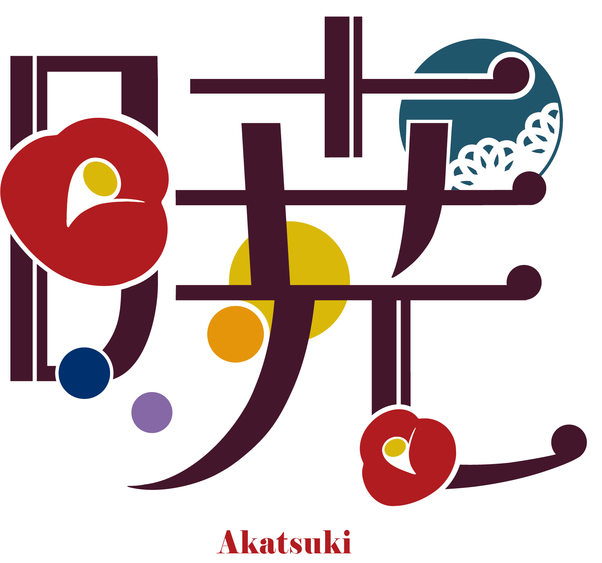

## Overview

第79回「暁」は、生成りに赤茶と濃い茶を合わせ、椿・雲・円・切符を配置したデザインです。トップは縦書きと大きな構図でテーマを見せ、情報ページは共通の見出しと本文幅で読みやすくまとめています。

前年の「星瞬」で生まれた熱気や思いを受け継ぎ、新たな九大祭の始まりを「暁」に重ねています。限られた時間の出会いや感動が、来場者の心を照らすことを願ったテーマです。

ロゴの図柄には椿と黄・青・紫の円、青緑の模様を組み合わせています。ページ内の椿、雲、波線、円も、テーマの表現として使います。

このページは開催前のサイトをもとに、配色と構成を紹介しています。

## Colors

| 色           | 値        | 用途                           |
| ------------ | --------- | ------------------------------ |
| 生成り       | `#fffef6` | ページの基本背景               |
| 濃い茶       | `#402000` | 本文、見出し、枠               |
| 赤茶         | `#993333` | ヘッダー、強調、フォーカスの枠 |
| 黄色         | `#fff080` | ナビゲーションの反応           |
| 見出しの茶   | `#7e4c1e` | トップの節見出し               |
| 青緑         | `#1b6373` | テーマ領域の円                 |
| 切符の紙面   | `#fbf7ee` | 切符形リンクの背景             |
| 切り欠きの枠 | `#eee9c9` | 装飾枠の背景                   |

冒頭の円には、青から淡い赤へ移るグラデーションを使います。詳細リンクは背景`#884741`と生成りの文字を組み合わせ、ポインターを重ねると背景を`#c7b299`へ変えます。

## Typography

英字はEB Garamond、日本語はShippori Mincho B1を基本とします。続いてYu Mincho、Hiragino Mincho ProN、serifを指定します。

| 用途                   | 文字の指定                         |
| ---------------------- | ---------------------------------- |
| 本文                   | 行高1.9を基準にする                |
| 情報ページのタイトル   | `clamp(1.15rem, 3vw, 2rem)`        |
| 節の見出し             | `clamp(1.25rem, 3vw, 1.6rem)`      |
| 小見出し               | `clamp(1.05rem, 2.5vw, 1.25rem)`   |
| トップの見出し         | 3vw、太さ400、縦書き               |
| 狭い画面のトップ見出し | `clamp(1.3rem, 5vw, 2rem)`、横書き |

`clamp()`は、最小値と最大値の範囲で画面幅に応じた大きさを指定する方法です。トップの日本語は縦書きを生かし、英語は横書きで表示します。同じ枠へ無理に収めず、言語に合わせて配置を変えています。

## Layout

冒頭は赤茶と生成りの斜めの境界、夜明けの色を使った円、テーマ画像、雲、祭名と日時で構成します。日時は画像の外に文字で表示します。

| 領域           | 配置の基準                                  |
| -------------- | ------------------------------------------- |
| ヘッダー       | 高さ4.5rem。内容の最大幅75rem               |
| 通常の本文     | 最大幅64rem、左右の余白を確保               |
| 本文の節       | 上下2remの余白                              |
| ページタイトル | 最小高さ22rem、二重の枠と円の装飾           |
| 切符形のリンク | 幅100%、最大32rem                           |
| 企画一覧       | カードを自動で複数列に配置。600px以下で一列 |

トップの大きな構図と、情報ページの本文幅を使い分けます。幅768px以下ではヘッダーのリンクを右側から開くメニューにまとめます。

## Elevation & Depth

切符形のリンクには薄い枠と弱い影を付け、紙の重なりを表します。ポインターやキーボードで操作すると影が広がり、半券の折り目が強調されます。

ページタイトルの円にも淡い影を付けます。本文全体に影を広げず、切符や円の立体感に使っています。

## Shapes

切符の紙面と半券の間には、点線と円形の切り欠きを置きます。外角は0.6rem、内側の破線枠は0.35remの角丸です。

四隅を円で抜いた装飾枠も使います。外側を丸める角丸とは形が異なるため、文字との距離を取ります。節の見出しには椿と波線、小見出しには小さな飾りと破線を添えています。

## Components

| 要素               | 役割と特徴                                     |
| ------------------ | ---------------------------------------------- |
| トップのテーマ領域 | ロゴ、雲、円、祭名、日時を組み合わせる         |
| 共通見出し         | 椿と波線、小さな飾りと破線で階層を分ける       |
| ページタイトル     | 二重の枠と浮かぶ円。狭い画面では円を隠す       |
| 切符形のリンク     | 紙面、点線、切り欠き、半券で行き先を示す       |
| 企画一覧           | 分類、検索、お気に入り、件数、追加表示         |
| ヘッダー           | 主要リンク、開閉メニュー、本文へ移動するリンク |

切符形のリンクは、ページを移動するための装飾です。予約済みや入場資格を示す券とは用途を分けます。外部のサイトへ移動する場合は「外部サイトへ」と表示します。

画像は、情報を伝えるものと装飾を区別します。テーマ画像には説明を付け、雲などの装飾は読み上げの対象から外します。おすすめの一覧は、ポインターを重ねると停止します。動きを減らす設定では自動再生を止めます。

## Do's and Don'ts

生成りと赤茶、椿、縦書き、切符の形を生かし、情報の量と言語に合う配置を選びます。

| 生かす表現                                 | 避ける使い方                           |
| ------------------------------------------ | -------------------------------------- |
| トップは構図、情報ページは本文幅を重視する | 大きな装飾余白を企画一覧にも一律に使う |
| 日本語と英語で文字の向きを変える           | 英語や長い名称を縦書きの枠に詰め込む   |
| 切符形リンクに行き先を示す                 | 装飾を予約・入場の資格表示と混同させる |
| 切り欠きと文字の間に余白を取る             | 枠の形に文字を重ねる                   |
| 動きがなくても情報を読めるようにする       | 円や一覧の動きを止める手段を省く       |
